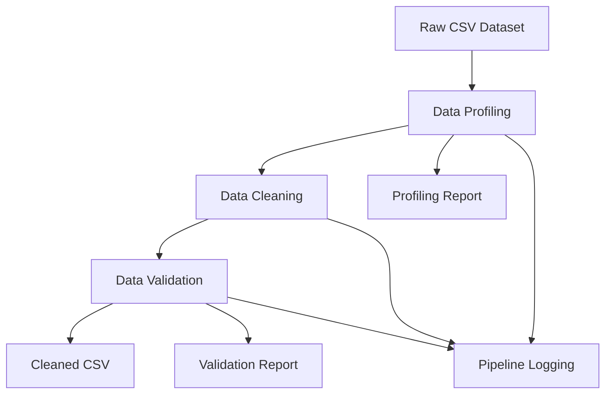

# Sprint 11 — Integration, Orchestration & Production Engineering

## 1. Overview

Sprint 11 integrates the Automated Data Quality Validation System into a single end-to-end pipeline. It provides command-line execution, YAML configuration, logging, Docker support, automated tests, and data versioning using DVC and Git LFS.

## 2. Objectives

- Integrate data profiling, cleaning, and validation into one pipeline.
- Execute the pipeline through a single CLI command.
- Support configurable input and output paths.
- Use YAML for pipeline configuration.
- Add information, warning, and error logging.
- Track the raw dataset using DVC.
- Configure Git LFS for large binary files and demonstration media.
- Add Docker support for consistent execution.
- Write integration tests using pytest.
- Document the architecture, execution steps, and results.

## 3. Project Structure

```text
automated-data-quality-validation-system-cadetx/
├── data/
│   └── raw/
│       ├── diabetic_data.csv
│       └── diabetic_data.csv.dvc
├── module4_pipeline/
│   └── logging_config.py
├── results/
│   ├── cleaned_data.csv
│   ├── profiling_report.json
│   ├── validation_report.json
│   └── pipeline.log
├── tests/
│   └── test_pipeline_integration.py
├── docs/
│   └── SPRINT_11.md
├── .dvc/
├── .gitattributes
├── .gitignore
├── config.yaml
├── Dockerfile
├── pipeline.py
└── requirements.txt
```

*Note: The exact files and folders may vary depending on the final implementation.*

## 4. Pipeline Workflow

The pipeline follows these stages:

1. **Input:** Load the source CSV dataset.
2. **Profiling:** Generate a report describing dataset dimensions, columns, data types, and missing values.
3. **Cleaning:** Apply the configured data-cleaning operations.
4. **Validation:** Check the cleaned data against the configured validation rules.
5. **Output:** Save the cleaned CSV, profiling report, validation report, and execution log.

### Architecture Diagram



## 5. Command-Line Interface

The pipeline can be executed with a single command:

```powershell
python pipeline.py --input data/raw/diabetic_data.csv --output results/
```

The CLI accepts:

- `--input`: Path to the source CSV dataset.
- `--output`: Directory where generated outputs are saved.

The pipeline should validate the input path and report errors clearly if the file is missing or cannot be processed.

## 6. YAML Configuration

The `config.yaml` file stores configurable pipeline settings, including:

- Pipeline input and output paths.
- Cleaning options.
- Validation rules.
- Logging settings.

Keeping settings in YAML makes it easier to update pipeline behaviour without changing the Python source code.

## 7. Logging

The pipeline records execution information in `results/pipeline.log`.

The logging system should support:

- **INFO:** Pipeline stages started or completed.
- **WARNING:** Recoverable issues, such as missing values or unexpected data conditions.
- **ERROR:** Failures that prevent a stage from completing.

Logs help identify failures and simplify debugging.

## 8. Data Versioning

### DVC

DVC is used to track the raw dataset without storing the complete dataset directly in Git.

Dataset tracking command:

```powershell
dvc add data/raw/diabetic_data.csv
```

This creates the tracking metadata file:

```text
data/raw/diabetic_data.csv.dvc
```

Check the current tracking state:

```powershell
dvc status
```

The expected result when the tracked data is unchanged is:

```text
Data and pipelines are up to date.
```

The `.dvc` metadata